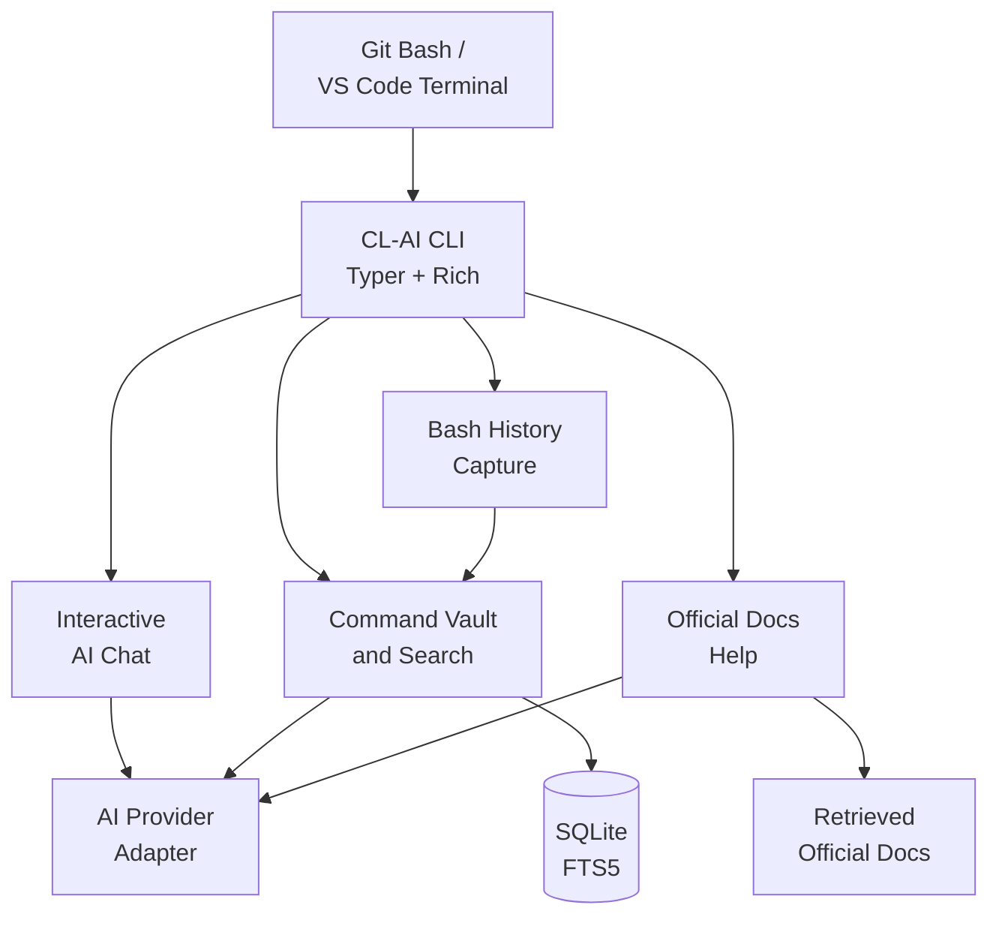

# CL-AI

**An AI-powered command companion for DevOps and SRE workflows—right in your terminal.**

CL-AI helps developers **understand, save, organize, and retrieve terminal commands** without losing useful commands in shell history or scattered notes. It combines conversational AI, a persistent SQLite Command Vault, Git Bash integration, and online research grounded in official documentation.

**Current version:** `v0.1.0` · **Platform:** Windows / Git Bash (including the VS Code integrated terminal) · **Status:** Functional v0.1; additional capabilities are planned

> CL-AI is an assistant, not an autonomous operator. It never executes AI-suggested shell commands or makes infrastructure changes on your behalf.

## Highlights

| Feature | What it does |
| --- | --- |
| **Terminal AI chat** | Explains DevOps concepts and commands in plain language through a configured AI provider. |
| **AI command documentation** | Generates a title, category, explanation, flag breakdown, tags, and risk notes before you save a command. |
| **SQLite Command Vault** | Stores commands locally with metadata, provenance, and verification state. Supports saving, listing, viewing, editing, and deleting. |
| **Natural-language search** | Finds **existing saved commands** by intent or keywords, with optional category filters. Does not invent matches. |
| **Official documentation research** | Researches questions through live public documentation retrieval, displays sources, and can save a selected suggested command. |
| **Git Bash history capture** | Opt-in `save-last` integration captures a previous shell command for review without executing it again. |
| **Safety checks** | Rejects recognizable embedded credentials, flags selected risky commands, and requires review before saving. |

## See CL-AI in Action

```bash
# Ask the AI to explain a command (interactive conversation)
cl-ai

# Generate documentation and save a command
cl-ai save "git log --oneline -5"

# Search commands that are already in your Vault
cl-ai find "recent Git commits"

# Research official documentation and show the source URLs
cl-ai helpme "What does docker compose ps do?"

# View your saved commands
cl-ai list
```

A saved command has a reviewable record that may include its exact text, title, description, important flags, tags, risk level, source, working directory, timestamp, and verification status. **Saved does not mean executed or verified.**

<!-- When your REAL terminal screenshots are ready, add them to
     assets/screenshots/ and uncomment the following lines.


-->

## How It Works



**Python handles** command capture, validation, risk checks, and local storage. **The AI model handles** explanations and structured summaries. **You control** what is saved and which commands are actually run in your terminal.

## Tech Stack

| Area | Technologies |
| --- | --- |
| Application | Python 3.11+, Typer, Rich, Prompt Toolkit |
| AI integration | LangChain, OpenAI-compatible API endpoints (including NVIDIA NIM and Qwen) |
| Validation | Pydantic |
| Local persistence and retrieval | SQLite, FTS5 |
| Testing | Pytest with mocked model and web responses |
| Shell | Git Bash integration (opt-in) |

## Quick Start

### 1. Requirements

- Windows with Git Bash (or the Git Bash terminal in VS Code)
- Python **3.11 or newer**
- Internet access and your own supported model API credentials **for AI chat, AI documentation, and online help**

Local Command Vault commands with `--no-ai` work without AI credentials.

### 2. Install

```bash
git clone https://github.com/Fredrick-Tario/cl-ai.git
cd cl-ai

python -m venv .venv
source .venv/Scripts/activate
python -m pip install -e ".[dev]"

cl-ai --version
cl-ai --help
```

### 3. Configure an AI provider

Create a local `.env` from the committed template **only if you don't have one yet**:

```bash
test -f .env || cp .env.example .env
```

For **NVIDIA NIM**, set the following values in `.env`:

```dotenv
AI_PROVIDER=nvidia_nim
AI_API_KEY=replace-with-your-own-api-key
AI_BASE_URL=https://integrate.api.nvidia.com/v1
AI_MODEL=replace-with-a-model-id-available-to-your-account
```

For another compatible endpoint, select `AI_PROVIDER=openai_compatible` and optionally set `AI_PROVIDER_NAME`. Existing Qwen-specific `QWEN_*` settings remain supported with `AI_PROVIDER=qwen`.

**Never commit `.env` or include real API credentials in screenshots.** Model access, quotas, pricing, and supported model IDs depend on the provider and your account.

### 4. Start a conversation

```bash
cl-ai
```

Ask a question such as:

```text
Explain the difference between terraform plan and terraform apply.
```

Type `exit` to return to Git Bash. CL-AI commands such as `cl-ai list` must be run **outside** the chat prompt; the chat interface reminds you of this rather than pretending to execute them.

## Command Reference

### Save, inspect, and manage commands

```bash
# AI-generated documentation + review before saving
cl-ai save "docker compose ps"

# Save locally without contacting the AI provider
cl-ai save "git status --short" --title "Check Git changes" --no-ai

# Save without the final confirmation prompt
cl-ai save "kubectl get pods" --no-ai --yes

# View and manage records
cl-ai list
cl-ai list --limit 10
cl-ai list --category Docker
cl-ai show 1
cl-ai edit 1
cl-ai delete 1
```

`show`, `edit`, and `delete` use record IDs displayed by `cl-ai list`. Deletion is permanent in v0.1; automatic backup and restore are not implemented.

### Find commands you have already saved

```bash
cl-ai find "check running Docker services"
cl-ai find "recent commits" --category Git
cl-ai find "Kubernetes pods" --limit 5
```

Search uses actual SQLite records. If there is no match, CL-AI reports that instead of generating a fictional command. For a command you haven't saved, use `helpme` to research documentation instead.

### Research official documentation

```bash
cl-ai helpme "What does docker compose ps do?"
cl-ai helpme "How do I inspect Kubernetes Pod logs?"
cl-ai helpme "What does terraform import do?"
```

The feature retrieves public documentation from supported official sources, then asks the model to explain the retrieved evidence. Results can include suggested commands, prerequisites, risk warnings, and source URLs.

To review and save a numbered suggestion from a research result:

```bash
cl-ai helpme "What does terraform import do?" --save 1
```

The `--save` option **runs the research again**, so review the numbered results from that invocation before confirming. Suggested commands are never executed. Documentation availability depends on live websites and your AI endpoint.

### Capture your previous Git Bash command

Enable the optional shell wrapper in your **current** Git Bash session:

```bash
source <(cl-ai shell-init)
```

Then:

```bash
git status --short
cl-ai save-last --no-ai

# Alternative wording supported by the Bash wrapper:
git log -1 --oneline
cl-ai save the command --no-ai
```

The wrapper searches recent history for a non-CL-AI command, previews it, and sends the text to CL-AI for review. It **does not rerun the command or recover its previous output**. If history isn't available, manual paste is offered.

To enable the wrapper in future Git Bash sessions, you can manually add `source <(cl-ai shell-init)` to your `~/.bashrc`.

## Privacy, Safety, and Limitations

- **Local by default:** Vault records are stored at `~/.cl-ai/cl_ai.db`, or under your configured `CLAI_DATA_DIR`.
- **No implicit execution:** CL-AI saves and suggests command text, but does not run shell commands or apply infrastructure changes on your behalf.
- **Secret awareness:** Known literal credential patterns are rejected before storage or AI documentation. This is a safeguard, not a guarantee of detecting every secret.
- **Risk awareness:** Selected dangerous or cost-incurring commands receive additional risk warnings; AI-generated explanations still require review.
- **Source transparency:** Online-help answers are based on retrieved official documentation and display their sources. Retrieval can fail when external search or documentation sites change.
- **Verification matters:** A command being saved or suggested is not evidence that it succeeded.
- **No autonomous operations:** v0.1 does not inspect your running infrastructure, capture logs, execute diagnostics, manage incidents, or generate runbooks.

## Testing

The test suite uses mocked model and web responses, so automated tests do not require live paid AI requests.

```bash
python -m pytest -q
```

For a live smoke test, use a separate data directory to avoid changing your everyday Vault:

```bash
export CLAI_DATA_DIR="$PWD/data/demo"
cl-ai save "git status --short" --no-ai --yes
cl-ai list
cl-ai find "git status"
```

## Roadmap

| Milestone | Scope | Status |
| --- | --- | --- |
| **v0.1 — Command Companion** | AI chat, Command Vault, structured AI documentation, search, official online help, Git Bash capture | **Implemented** |
| **v0.2 — Incident Memory** | Error logs, troubleshooting attempts, verified outcomes, reusable runbooks | Planned |
| **v0.3 — Terraform Insights** | Deterministic plan analysis and deployment history | Planned |
| **v0.4 — Troubleshooting Agent** | Permission-based, evidence-grounded diagnostic assistance | Planned |
| **v1.0 — Stable Release** | Packaging, deeper hardening, recovery/export, and end-to-end reliability | Planned |

The detailed specifications and acceptance criteria are in [**CL-AI Development Plan**](docs/CL-AI-PLAN.md).

---

**Built as a hands-on exploration of AI-assisted developer tooling, practical DevOps workflows, and reliable, human-reviewed automation.**
